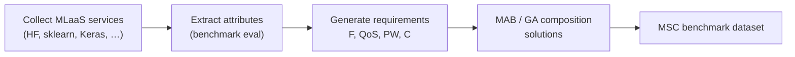

<!-- _class: lead -->
<!-- _paginate: false -->

# Benchmark Dataset Generator for MLaaS Ecosystems

<p class="tagline">MSC: A Benchmark Dataset for Machine Learning as a Service (MLaaS) Composition</p>

<p>Joshua Boland · MATH3004 Industrial Project</p>
<p>BSc Data Science · Supervisors: A/Prof Sajib Mistry & Deepak Kanneganti</p>

---

<!-- _class: section -->

# Motivation

## IoT, MLaaS, and service composition

<ul>

<li><strong>MLaaS</strong> lets organisations use cloud ML without owning full infrastructure (SageMaker, Azure ML, Hugging Face).</li>
<li>Complex applications often need <strong>multiple ML services</strong>—preprocessing, classification, summarisation—in one pipeline.</li>
<li><strong>MLaaS composition</strong> selects and combines services under accuracy, latency, cost, and reliability constraints.</li>

</ul>

<blockquote>
Providers expose limited model and QoS detail. Research lacks public benchmarks with requirements <em>and</em> composition solutions—unlike QWS and WS-DREAM for web services.
</blockquote>

<p class="cite">Proposal §1 · ICSOC 2026 §1 (Kanneganti et al.; Al-Masri & Mahmoud 2008; Zheng et al. 2013)</p>

---

# Research gap

## Why web-service datasets are not enough

| Dataset | MLaaS-specific | Functional attrs | Rich QoS | Internal params | XAI | Composition |
| --- | --- | --- | --- | --- | --- | --- |
| QWS | <span class="no">✗</span> | <span class="no">✗</span> | <span class="partial">◐</span> | <span class="no">✗</span> | <span class="no">✗</span> | <span class="no">✗</span> |
| WS-DREAM | <span class="no">✗</span> | <span class="no">✗</span> | <span class="partial">◐</span> | <span class="no">✗</span> | <span class="no">✗</span> | <span class="no">✗</span> |
| HSC | <span class="partial">◐</span> | <span class="yes">✓</span> | <span class="partial">◐</span> | <span class="partial">◐</span> | <span class="no">✗</span> | sequential only |
| **MSC (ours)** | <span class="yes">✓</span> | <span class="yes">✓</span> | <span class="yes">✓</span> | <span class="yes">✓</span> | <span class="yes">✓</span> | <span class="yes">✓</span> |

<p class="cite">Adapted from ICSOC 2026 Table 1 · HSC: Wang et al., ICSOC 2024</p>

---

# Project objectives

## MATH3004 proposal — five aims

| # | Objective |
| ---: | --- |
| 1 | **Configurable framework** — diverse ML task families, models, and training conditions |
| 2 | **Training + inference** — realistic measurements from commonly used models |
| 3 | **Functional + QoS metrics** — individual services and **compositions** |
| 4 | **Evaluate** selection/composition algorithms against prior research |
| 5 | **Reproducibility** — documentation and tools to extend datasets |

<p style="font-size:0.78em;color:#64748b;margin-top:0.5em;">
This repository implements the <strong>service-generation</strong> core; composition requirements and solutions are built on the published MSC workflow.
</p>

---

# MSC dataset at a glance

<div class="columns four">

<div style="text-align:center">
<div class="stat">25,900</div>
<div class="stat-label">MLaaS services</div>
</div>

<div style="text-align:center">
<div class="stat">20,000</div>
<div class="stat-label">composition requirements</div>
</div>

<div style="text-align:center">
<div class="stat">12</div>
<div class="stat-label">task families</div>
</div>

<div style="text-align:center">
<div class="stat">5</div>
<div class="stat-label">provider sources</div>
</div>

</div>

<ul style="font-size:0.88em;margin-top:0.6em">

<li>Largest known MLaaS composition dataset — inference and fine-tuned services</li>
<li>10,000 sequential + 10,000 collaborative composition scenarios</li>
<li>Benchmark solutions via <strong>MAB-based composability</strong> algorithm</li>

</ul>

<p class="cite">ICSOC 2026 abstract & §3 · Anonymous release: anonymous.4open.science/r/MLaaS_Dataset_Gen-F3C4</p>

---

# MLaaS composition types

<div class="columns">

<div class="card">

### Sequential composition

<ul>
<li>Workflow: output of service <em>i</em> → input of service <em>i+1</em></li>
<li>Example: medical image → text caption → clinical summary</li>
<li>Models workflow order and stage-wise QoS aggregation</li>
</ul>

</div>

<div class="card">

### Collaborative composition

<ul>
<li>Multiple services merged into one unified capability</li>
<li>Example: HAR — one service for walk/run, another for sit</li>
<li>Models compatibility across functional and QoS dimensions</li>
</ul>

</div>

</div>

<p class="cite">ICSOC 2026 §1 · Proposal Fig. 1 (MLaaS composition illustration)</p>

---

# MSC collection workflow



| Phase | Output |
| --- | --- |
| **3.1 Services** | Normalized functional + QoS records per provider instance |
| **3.2 Requirements** | Application-driven requests (healthcare vs finance profiles) |
| **3.3 Composition** | Feasible combinations optimising sequential / collaborative objectives |

<p class="cite">ICSOC 2026 Fig. 2 & §3</p>

---

# What each MLaaS service records

## Key attributes (ICSOC Table 3)

| Symbol | Attribute | Role in composition |
| --- | --- | --- |
| Δ, Dₙ | Data distribution & size | Functional compatibility |
| w | Model parameters | Alignment across services |
| A | Accuracy | Quality objective |
| L | Latency | QoS constraint |
| R | Reliability | Consistency under load |
| T, C | Compute time & cost | Resource efficiency |
| X | Explainability | Perturbation sensitivity score |

<p style="font-size:0.78em;color:#64748b;">
Also captured: tail latency, cost efficiency, popularity, modality, training regime, split provenance.
</p>

---

# Explainability as a QoS metric

<div class="columns">

<div class="card">

### Traditional QoS

<ul>
<li>Latency · reliability · cost · throughput</li>
<li>Well defined for web/cloud services (QWS, WS-DREAM)</li>
</ul>

<h3>ML adds interpretability</h3>
<ul>
<li>Healthcare: trust clinical predictions</li>
<li>Finance: auditability and compliance</li>
</ul>

</div>

<div class="card">

### The challenge

<ul>
<li>Define <strong>X consistently</strong> across 12 task families</li>
<li>Text, vision, tabular need different XAI tooling</li>
</ul>

<h3>Why not SHAP / Grad-CAM / LIME everywhere?</h3>
<ul>
<li>Task-specific integrations × thousands of services</li>
<li>Computationally prohibitive for batch dataset generation</li>
</ul>

</div>

</div>

<blockquote>
<strong>Engineering decision:</strong> perturbation-based sensitivity as a generalised explainability proxy — perturb inputs, observe output stability, stable models score higher (<code>explainability_score</code>).
</blockquote>

<p style="font-size:0.76em;color:#64748b;">
Implemented in <code>services/perturbation.py</code> · stored in <code>service_metrics</code> · honours-level: recognised the gap, chose a scalable cross-task proxy (not a full XAI taxonomy).
</p>

---

# Simulating realistic ML providers

## Generating heterogeneous ML service behaviour from real model execution

<div class="columns">

<div class="card" style="font-size:0.72em">

**Heterogeneity pipeline**

Base models → Different datasets → Training conditions → Runtime behaviours → **ML service records**

</div>

<div>

<span class="pill">1 · Task diversity</span>
<span class="pill">2 · Service variation ★</span>
<span class="pill">3 · Runtime</span>
<span class="pill">4 · Behaviour</span>
<span class="pill">5 · Catalogue</span>

</div>

</div>

<div class="columns three">

<div class="card">

### 1 · Task & model diversity

<ul>
<li>NLP, vision, tabular</li>
<li>Multiple architectures</li>
<li>Benchmark datasets</li>
</ul>

</div>

<div class="card">

### 2 · Service variation ★

<ul>
<li>Hyperparameters (LR, batch, epochs)</li>
<li>IID vs non-IID · training skew</li>
<li>Fine-tuned vs inference-only</li>
</ul>

</div>

<div class="card">

### 3 · Runtime execution

<ul>
<li>Real train / inference runs</li>
<li>Not synthetic metadata</li>
<li>CPU / GPU tracking</li>
</ul>

</div>

</div>

<div class="columns">

<div class="card">

### 4 · Behavioural measurement

<ul>
<li>Prediction quality · latency</li>
<li>Reliability · resource use</li>
<li>Explainability (perturbation proxy)</li>
</ul>

</div>

<div class="card">

### 5 · Dataset generation

<ul>
<li>Standardised service records</li>
<li>Reproducible experiments</li>
<li>Composition-ready catalogue</li>
</ul>

</div>

</div>

<blockquote>
<strong>The goal was not to find the best ML model</strong> — the goal was to simulate many realistic ML providers with diverse behaviours.
</blockquote>

---

# Implementation architecture

## From configuration to a benchmark-ready dataset

<div class="flow">

<span class="pill" style="background:#3b82f6;color:#fff">1 Registry</span>
<span class="arrow">→</span>
<span class="pill" style="background:#22c55e;color:#fff">2 Manifest</span>
<span class="arrow">→</span>
<span class="pill" style="background:#f97316;color:#fff">3 Execution</span>
<span class="arrow">→</span>
<span class="pill" style="background:#a855f7;color:#fff">4 Metrics</span>
<span class="arrow">→</span>
<span class="pill" style="background:#1e3a8a;color:#fff">5 Dataset</span>

</div>

<div class="columns five" style="font-size:0.72em">

<div class="card"><strong>1. Registry</strong><ul><li>Curated tasks, models, datasets</li><li>HF + generic providers</li></ul></div>
<div class="card"><strong>2. Manifest</strong><ul><li>hf-manifest · many configurations</li><li>Hyperparameters, splits, regimes</li></ul></div>
<div class="card"><strong>3. Execution</strong><ul><li>run-manifest · train/inference</li><li>Real CPU/GPU runtime</li></ul></div>
<div class="card"><strong>4. Metrics</strong><ul><li>QoS · reliability · resources</li><li>Explainability score</li></ul></div>
<div class="card"><strong>5. Dataset</strong><ul><li>services.db</li><li>One row → one provider</li></ul></div>

</div>

<blockquote>
<strong>One manifest row = one simulated ML provider</strong> — each execution produces one benchmark catalogue record.
</blockquote>

<p style="font-size:0.76em;color:#64748b;">
Generates heterogeneous, realistic ML service providers and captures behaviour for reproducible benchmarking.
</p>

---

# Why task diversity matters

## Different ML tasks produce different runtime, QoS, and explainability behaviour

Web-service benchmarks assume one QoS profile. **ML tasks differ** in compute, latency, memory, and trust signals.

<div class="columns three">

<div class="card">

### NLP

<ul>
<li>Variable sequence lengths → latency spread</li>
<li>Token vs sentence workloads</li>
<li>Text-unit explainability</li>
</ul>

</div>

<div class="card">

### Vision

<ul>
<li>High compute & GPU cost</li>
<li>Throughput vs batch size</li>
<li>Spatial vs textual XAI</li>
</ul>

</div>

<div class="card">

### Segmentation

<ul>
<li>Large memory / VRAM</li>
<li>Longer runtimes than cls</li>
<li>Pixel-level QoS trade-offs</li>
</ul>

</div>

</div>

<div class="columns">

<div class="card">

### Classification

<ul>
<li>Often faster inference</li>
<li>Accuracy-sensitive ranking</li>
<li>Skew affects reliability</li>
</ul>

</div>

<div class="card">

### Regression / tabular

<ul>
<li>Lower compute than deep DL</li>
<li>Feature-space behaviour</li>
<li>RMSE / MAE cost profiles</li>
</ul>

</div>

</div>

<blockquote>
The goal was not simply to include many tasks — the goal was to generate <strong>realistic variation in ML service behaviour</strong>.
</blockquote>

<p class="cite" style="font-size:0.7em">12 MSC families · generator: <code>hf-manifest --task-keys</code></p>

---

# Downstream research on the service catalogue

## Core: dataset generation · Composition & benchmarking as application layers

<div class="columns">

<div class="card">

### Extending to composition research

**Service records → Requirements → Applications**

<ul>
<li>Accuracy needs · latency limits · cost constraints</li>
<li>Recommendation · orchestration · selection · evaluation</li>
</ul>

<p style="font-size:0.72em">MSC paper layer — not the generator CLI core</p>

</div>

<div class="card">

### Benchmarking ML service behaviour

| | Traditional | **MLaaS generator** |
| --- | --- | --- |
| QoS | Limited | Rich behavioural metrics |
| Behaviour | Static | Runtime variability |
| ML | Minimal | Accuracy + explainability |
| Providers | Homogeneous | Heterogeneous |

<ul>
<li>Fair comparison · reproducible runs · realistic optimisation problems</li>
</ul>

</div>

</div>

<blockquote>
Once realistic ML service records exist, they can support higher-level research like <strong>composition and orchestration</strong>.
</blockquote>

---

# Key contribution

**A reproducible framework for generating heterogeneous ML service ecosystems.**

### Enables

<ul>
<li>Fair benchmarking</li>
<li>Reproducible evaluation</li>
<li>Runtime QoS analysis</li>
<li>ML service orchestration research</li>
<li>Future composition research</li>
</ul>

---

# Limitations and open challenges

<div class="columns">

<div class="card">

### Explainability

No universal XAI metric across all ML tasks — perturbation proxy is an explicit trade-off.

</div>

<div class="card">

### Runtime cost

Large-scale evaluation is computationally expensive; caps and time budgets required.

</div>

</div>

<div class="columns">

<div class="card">

### Real-world realism

Public models may not fully reflect commercial MLaaS provider behaviour.

</div>

<div class="card">

### Ecosystem evolution

Benchmark catalogues must evolve alongside changing ML ecosystems.

</div>

</div>

---

# Demo — reproduce services locally

```bash
python -m mlaas_data_generator.cli.main hf-manifest \
  --manifest-profile test \
  --total-services 8 \
  --output outputs/service_manifest.xlsx

python -m mlaas_data_generator.cli.main run-manifest \
  --file outputs/service_manifest.xlsx --dry-run

python -m mlaas_data_generator.cli.main run-manifest \
  --file outputs/service_manifest.xlsx \
  --db outputs/services.db
```

<p style="font-size:0.72em;color:#64748b;">
Scale path: test → balanced → benchmark profiles; multi-GPU via <code>--workers</code>.
</p>

---

<!-- _class: lead -->

# Summary

| | |
| --- | --- |
| **Problem** | No realistic benchmark for heterogeneous ML service behaviour |
| **Solution** | A configurable ML service dataset generator |
| **Method** | Execute diverse ML providers and capture runtime behaviour |
| **Output** | Standardised benchmark-ready service records |
| **Contribution** | Reproducible MLaaS benchmarking and future orchestration research |

<blockquote>
The project shifts benchmarking from static web services toward <strong>realistic, behaviour-driven ML service ecosystems</strong>.
</blockquote>

<p style="font-size:1.05em;">Questions?</p>
